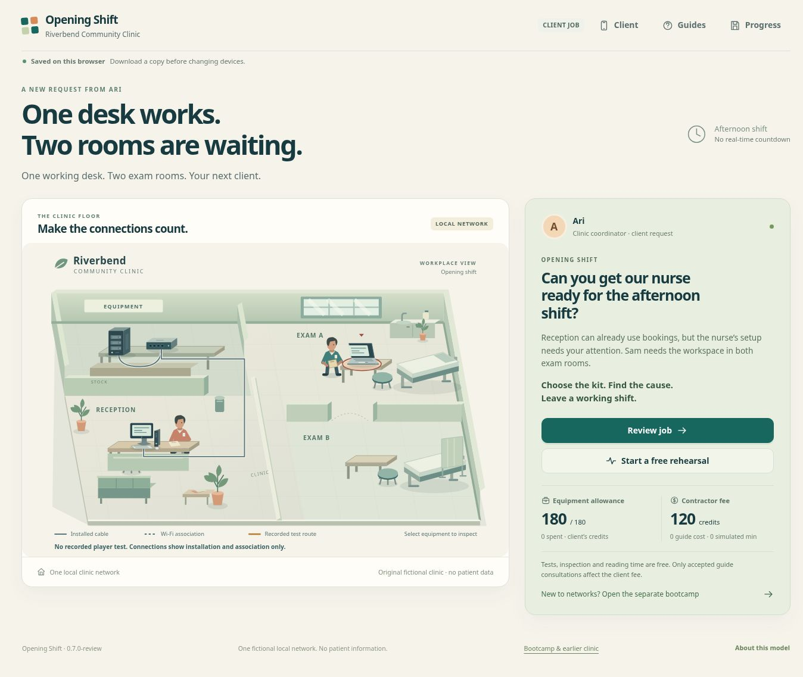

# Connect the Clinic — bootcamp and Opening Shift

An original browser game about helping Riverbend Community Clinic choose equipment, connect a network, diagnose faults, make access decisions and explain consequences for people. New players first learn equipment, cables, connections, addresses and masks at an interactive training bench. Then Opening Shift starts with working reception and an unfinished nurse workspace: choose suitable equipment, investigate a real fault, test in both rooms and explain an access decision. There are no game accounts, paid AI calls or package dependencies to play.

## Open the game

**Integrated bootcamp and field job:** https://ctwadden.github.io/digital-society-sl/connect-the-clinic/dist/opening-shift.html

**Preserved bootcamp and earlier clinic:** https://ctwadden.github.io/digital-society-sl/connect-the-clinic/dist/

The shorter project address, https://ctwadden.github.io/digital-society-sl/connect-the-clinic/, opens Opening Shift. The current programme preserves valid 0.7 field saves and adds a separate training record. The older 0.6 game still uses its own namespace; resume/import its files in the earlier game. No previous work is converted into unearned training completion. See [bootcamp release checks](qa/BOOTCAMP_RELEASE.md) for current verification status, [the previous Opening Shift checks](qa/OPENING_SHIFT_RELEASE.md), and the [earlier published-browser checks](qa/PUBLISHED_GITHUB_0_6.md) and [migration record](MIGRATION.md) for the preserved build.

**Source folder:** https://github.com/ctwadden/digital-society-sl/tree/main/connect-the-clinic

The existing0.6 network engine remains the causal core. The field mission and original clinic assets live under `dist/opening/`; the training engine, mentor interface and bench live under `dist/bootcamp/`. One programme state owns both records. The parent course repository's existing Pages workflow publishes this isolated subfolder. There is no new hosting subscription or service.

## Run and test locally

From this `connect-the-clinic` project folder, run:

```sh
python -m http.server 8000
```

On Windows with the Python launcher, use `py -m http.server 8000`. Open http://localhost:8000/ in a modern browser. If the command is `python3` on your system, use `python3 -m http.server 8000`. Serve over HTTP; opening HTML through `file://` is not a supported way to load modules or test persistence.

For automated tests, use Node.js and run:

```sh
npm test
```

No `npm install` is required. The exported suite includes its original synthetic regression fixtures. See [test results](qa/EXPORT_TEST_RESULTS.md) for the environment, result and limits.

## Learn, then take the clinic job

New campaigns open the bootcamp. Review the hardware and cable guide, then learn through five worked examples and six fresh practical tasks: equipment, Ethernet, IP address/mask, wireless, access and a changed fault. Training hints/retries are free. Completing the task conditions opens the first independent job; it does not award an IB grade or certify mastery. Existing field players can use **Bootcamp** and return without losing their clinic work.

In the field, review the phone brief and ask about the nurse's work. Choose the existing laptop or a tablet, inspect the equipment and use the relevant tools to get the nurse's workspace working. The **free rehearsal** keeps the independent client job intact and makes guidance free. In the client job, the shop uses a separate equipment allowance; unused client funds never become contractor income.

The game records actual tests from each room. An on-screen cable or an earlier passing result cannot certify a changed network. Use the handover to submit your own equipment, repair, privacy and limitation explanations, or mark an item for oral teacher review. Export evidence for your teacher and progress for recovery.



For the historical 0.7 release, the lead completed the published job and the changed physical-fault rehearsal, including actual evidence downloads, damaged/valid import, reload/drafts, reset and two-tab control. That release’s automated suite passed 212/212; current bootcamp results are recorded separately above. See the [published browser observations](qa/OPENING_SHIFT_BROWSER.md) for exact coverage, repaired defects and remaining school-device checks.

## Earlier bootcamp and wearable clinic

Select **Find reception’s port**. Choose reception’s Ethernet socket and a free switch socket, then connect and test. Jo guides the first connection, unplug/repair experiment and explanation. Choose **Start independent practice** when the guided lesson ends. Guidance in practice is free.


## For the teacher and future authors

- [Integrated bootcamp operating guide](docs/bootcamp/OPERATING_GUIDE.md), [learning design and materials](docs/bootcamp/LEARNING_DESIGN.md), [delegated run](docs/bootcamp/RUN.md), [bootcamp contract](docs/bootcamp/CONTRACT.md), [programme API](docs/bootcamp/API.md) and [training asset manifest](docs/bootcamp/ASSET_MANIFEST.md).
- [Opening Shift operating guide](docs/opening-shift/OPERATING_GUIDE.md), [run and roles](docs/opening-shift/RUN.md), [shared contract](docs/opening-shift/CONTRACT.md), [engine API](docs/opening-shift/ENGINE_API.md), [learning design](docs/opening-shift/LEARNING_DESIGN.md), [original asset manifest](dist/opening/assets/manifest.json) and [reusable specialist prompts](docs/opening-shift/WORKER_PROMPTS.md): the delegated implementation and its bounded ownership.
- [Gameplay research and first-client design](docs/research/gameplay-review-2026-11-16/README.md): the 16 November research and original implementation blueprint. Historical research documents retain their own stage/status; current implementation status is in the Opening Shift run and release checks.
- [Teacher guide](docs/TEACHER_GUIDE.md): lesson sequence, expected paths, privacy choices, evidence and recovery.
- [School pilot checklist](qa/SCHOOL_PILOT.md): teacher walkthrough and a small student pilot.
- [Shared contract](CONTRACT.md), [model](docs/MODEL.md) and [engine API](docs/ENGINE_API.md): authoritative state, actions, rules and deliberate simplifications.
- [Worker prompts](docs/WORKER_PROMPTS.md), [specialist roles](docs/SPECIALIST_SKILLS.md) and [game experience roles](docs/GAME_EXPERIENCE_ROLES.md): reuse the process for another topic.
- [Source alignment](docs/SOURCE_ALIGNMENT.md), [I-can evidence map](docs/Clinic_I_Can_Evidence_Map_v0.4.csv) and [asset manifest](asset-manifest.json): instructional scope and original asset provenance.

Private teacher-source links, authoring-account skill locators and former hosting metadata were removed from this public copy. Course-source titles and bibliographic references remain for attribution; the source lesson packs, textbook and teacher answer materials are not redistributed. Historical review records may refer to omitted archived files. This export does not add a redistribution licence or change authorship.

## Progress, privacy and evidence

Progress stays in the **same device, browser profile and site origin**. It does not sync through GitHub or travel to another computer. Before moving between devices, choose **Download progress**, then import that programme progress JSON on the new device. The integrated entry also accepts valid 0.7 Opening Shift progress; 0.6 files belong in the separate earlier game. **Export evidence** produces the teacher record; it is not a restorable backup. Keep identifying information out of free-text explanations.

School profile cleanup, private browsing, blocked storage or download restrictions can affect retention. Export before changing browser/device or clearing data. A shared browser profile may contain another person's attempt; follow the teacher's clear-after-export routine. Different project paths under `ctwadden.github.io` share an origin, so parallel copies of this game need deliberate save namespaces.

The game asks for no student names, patient information or accounts. The host may retain ordinary security logs. Fictional income, speed, completion and hint use **do not automatically produce IB grades or certify mastery**; inspect decisions, tests and explanations alongside observation and discussion.

This is a **teacher review build**. Automated tests and development-browser checks do not establish classroom readiness. Actual managed school Windows browsers, download/import policies, assistive technology and a small student pilot remain to be checked.

