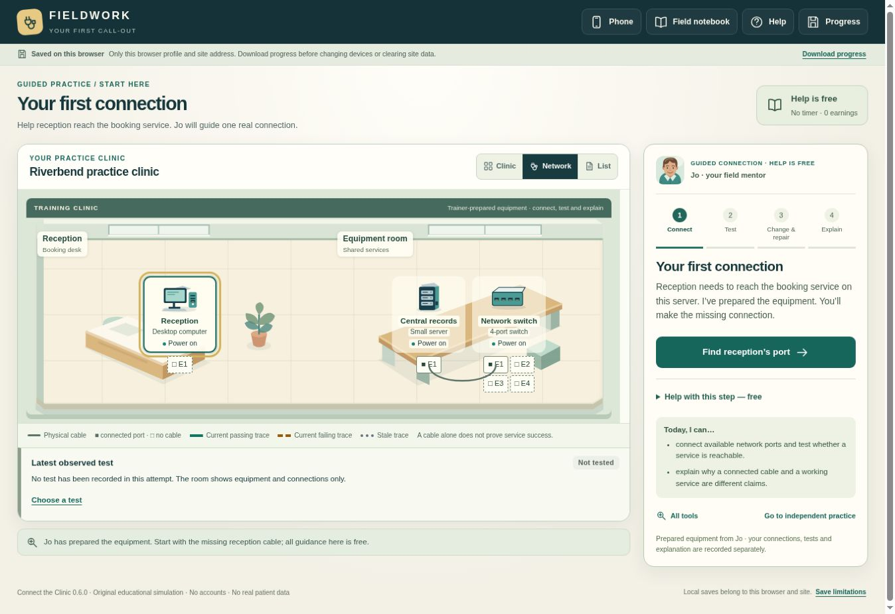

# Connect the Clinic — teacher review trial 0.6.0

An original browser game about helping Riverbend Community Clinic choose equipment, connect a network, diagnose faults, make access decisions and explain consequences for people. Start with Jo's guided connection lesson, then move into the bootcamp and independent client work. There are no game accounts, paid AI calls or package dependencies to play.

## Open the game

**Play:** https://ctwadden.github.io/digital-society-sl/connect-the-clinic/dist/

Published and verified on 16 November 2026. The shorter project address, https://ctwadden.github.io/digital-society-sl/connect-the-clinic/, opens the same game. See the [published-browser checks](qa/PUBLISHED_GITHUB_0_6.md) and [migration record](MIGRATION.md) for the exact scope and remaining school-device checks.

**Source folder:** https://github.com/ctwadden/digital-society-sl/tree/main/connect-the-clinic

The root entry opens `dist/`, which contains the unchanged 0.6.0 runtime. The parent course repository's existing Pages workflow publishes this isolated subfolder. There is no new hosting subscription or service.

## Run and test locally

From this `connect-the-clinic` project folder, run:

```sh
python -m http.server 8000
```

On Windows with the Python launcher, use `py -m http.server 8000`. Open http://localhost:8000/ in a modern browser. If the command is `python3` on your system, use `python3 -m http.server 8000`. Serve over HTTP; opening HTML through `file://` is not a supported way to load modules or test persistence.

For automated tests, use Node.js and run:

```sh
npm test
```

No `npm install` is required. The exported suite includes its original synthetic regression fixtures. See [test results](qa/EXPORT_TEST_RESULTS.md) for the environment, result and limits.

## Start playing

Select **Find reception’s port**. Choose reception’s Ethernet socket and a free switch socket, then connect and test. Jo guides the first connection, unplug/repair experiment and explanation. Choose **Start independent practice** when the guided lesson ends. Guidance in practice is free.



## For the teacher and future authors

- [Gameplay research and proposed first-client redesign](docs/research/gameplay-review-2026-11-16/README.md): the 16 November review of Aspire, the current experience and a more substantial Opening Shift. This is a design handoff; the live game is still 0.6.0.
- [Teacher guide](docs/TEACHER_GUIDE.md): lesson sequence, expected paths, privacy choices, evidence and recovery.
- [School pilot checklist](qa/SCHOOL_PILOT.md): teacher walkthrough and a small student pilot.
- [Shared contract](CONTRACT.md), [model](docs/MODEL.md) and [engine API](docs/ENGINE_API.md): authoritative state, actions, rules and deliberate simplifications.
- [Worker prompts](docs/WORKER_PROMPTS.md), [specialist roles](docs/SPECIALIST_SKILLS.md) and [game experience roles](docs/GAME_EXPERIENCE_ROLES.md): reuse the process for another topic.
- [Source alignment](docs/SOURCE_ALIGNMENT.md), [I-can evidence map](docs/Clinic_I_Can_Evidence_Map_v0.4.csv) and [asset manifest](asset-manifest.json): instructional scope and original asset provenance.

Private teacher-source links, authoring-account skill locators and former hosting metadata were removed from this public copy. Course-source titles and bibliographic references remain for attribution; the source lesson packs, textbook and teacher answer materials are not redistributed. Historical review records may refer to omitted archived files. This export does not add a redistribution licence or change authorship.

## Progress, privacy and evidence

Progress stays in the **same device, browser profile and site origin**. It does not sync through GitHub or travel to another computer. Before moving from the old review site or between devices, choose **Download progress**, then import that progress JSON on the new site. **Export evidence** produces the teacher record; it is not a restorable backup. Keep identifying information out of free-text explanations.

School profile cleanup, private browsing, blocked storage or download restrictions can affect retention. Export before changing browser/device or clearing data. A shared browser profile may contain another person's attempt; follow the teacher's clear-after-export routine. Different project paths under `ctwadden.github.io` share an origin, so parallel copies of this game need deliberate save namespaces.

The game asks for no student names, patient information or accounts. The host may retain ordinary security logs. Fictional income, speed, completion and hint use **do not automatically produce IB grades or certify mastery**; inspect decisions, tests and explanations alongside observation and discussion.

This is a **teacher review build**. Automated tests and development-browser checks do not establish classroom readiness. Actual managed school Windows browsers, download/import policies, assistive technology and a small student pilot remain to be checked.
