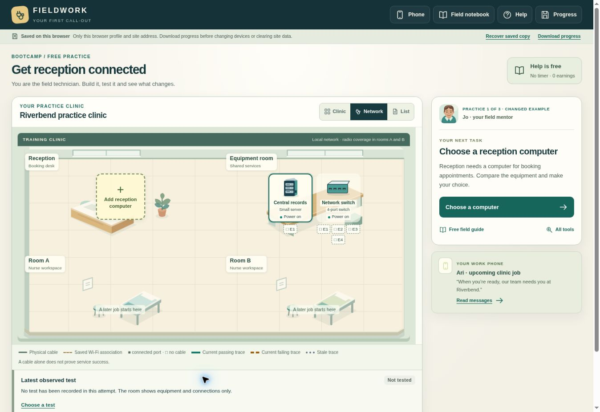

# Why the clinic does not yet feel like the intended game

**Lead review · 16 November 2026 · Connect the Clinic 0.6.0**

## Decision

The teacher's criticism is justified. We made the opening easier to understand, but the scale of the student's responsibility became too small. The current opening is a useful control lesson. The substantial client simulation still needs work.

The next development priority is **one complete client shift with investigation, resource choices, configuration, diagnosis and visible consequences**. Keep the introduction, the causal network model, accessibility and recovery. Treat the cabling rehearsal as a short part of preparation. Build the richer job before extending the city or producing more decorative art.

This is a research and redesign handoff. It does not claim the redesigned mission is already playable. The current review build remains at https://ctwadden.github.io/digital-society-sl/connect-the-clinic/dist/.

## What was investigated

Three bounded specialists researched historical gameplay, inspected visual/level evidence and independently audited the present model. The lead reopened primary sources, read the actual reports and played the published opening and first independent equipment task through its changed-example transition.

- [Aspire gameplay field notes](ASPIRE_GAMEPLAY_FIELDNOTES.md): edition-specific sources, contract examples, economy/progression observations and uncertainties.
- [Visual and level field notes](ASPIRE_VISUAL_LEVEL_FIELDNOTES.md): supplied images, inspected historical figures, current 0.6 screenshot and an original five-area clinic layout.
- [Independent current-game audit](CURRENT_GAMEPLAY_AUDIT.md): exact source references, full model route, alternate valid equipment plans and implementation boundaries.
- [First client mission specification](FIRST_CLIENT_MISSION.md): proposed next playable slice, ownership and acceptance tests.

Historical Aspire was not installed or played, and no full walkthrough video was watched. Documentary descriptions and image inspection are labelled separately. The managed browser is Linux Chromium, not a school Windows machine. No claim of measured enjoyment, beginner timing or classroom readiness follows from this review.

## The gap, made concrete

| Desired experience | Current 0.6 behavior | Design consequence |
| --- | --- | --- |
| Receive a client's problem and choose an approach | Fresh guided fixture supplies powered, addressed devices and the server cable | The student mainly follows a connection procedure |
| Build toward a result that remains visible | Independent station 1 resets to a new fixture after success | The place appears to lose the student's improvement even though history is retained |
| Apply understanding in a changed situation | Station 1 changes subnet but automatically assigns compatible new device addresses | The same equipment/cabling recipe passes twice without an address decision |
| Weigh equipment and cost | Several device combinations work, but all equipment is free | Written trade-offs have little economic consequence |
| Investigate a fault | The client brief and focus point toward an inherited nurse address setting | The independent task reveals too much of its diagnosis in advance |
| Use the phone to gather requirements | Messages mostly report events and can be marked read | The phone has atmosphere but little decision-making function |
| See a workplace improve | Technical results and paths are visible; staff work is mostly described | A passing test lacks a strong visible human payoff |
| Grow a small consultancy | One paid contract and one settlement are implemented | A longer customer/reinvestment progression does not yet exist |

The audit also found real depth worth preserving: static IPv4/masks, power and cable faults, wireless association, mobile device suitability, fresh/stale observations, two responsible access policies and a useful unplugged-uplink transfer task after address teaching. The entire game should not be dismissed as a fake network. Its systems are not yet arranged into a satisfying early game.

### A particularly important live observation

On the published site, I entered independent practice, chose a desktop, powered it, connected both Ethernet links and passed the reception test. Selecting **Try a changed example** then showed a new empty reception position and no cables, with a message naming `192.168.70.0/24`. It again asked **Choose a reception computer**. A separate model trace confirmed that the same device and cable choices pass both versions without `SET_STATIC_ADDRESS`.

That is repeated setup, with limited new reasoning. It is not data loss: the earlier attempt is retained. The correction should preserve the player's sense of building something, while introducing a new constraint or cause.

### What the prior revision got wrong

The earlier research correctly identified unclear controls and overexposed tools. The chosen response was an isolated, trainer-prepared link lesson. That response improved orientation but was too narrow to stand for the larger game promise. This review changes the next design priority; it does not invalidate the reliability tests or silently alter the current contract.

## Gameplay observations that should guide the redesign

### Give the student responsibility before adding complexity

The important question is: what has the student decided that the game did not already decide for them? A free port is a legitimate small choice, but the first client should also require choosing a diagnostic, deciding what equipment to keep, planning an address, or balancing convenience against access. Avoid making students operate every device control merely to increase the action count.

### Distinguish a taught operation from independent diagnosis

In training, Jo can identify a port or demonstrate an address comparison. In independent work, Ari should report a symptom. The student chooses an observation that narrows the cause. A diagnostic may clearly explain its result; withholding useful test feedback is not good difficulty. The task banner should not expose an unobserved answer simply because the engine already knows it.

### Keep the bootcamp, but make each challenge add something

The teacher explicitly wanted preparation before practical work. Preserve that intention. Replace repeated empty-scene setup with three connected preparation goals: understand equipment/physical path; assign an unused address using the provided network card; distinguish an address problem from a missing physical path. Free help stays available throughout.

The guided cable rehearsal can remain at the start, clearly labelled as a short controls warm-up. Its target duration is a planning hypothesis, not a measured claim. Students should see the upcoming client brief from the beginning and understand why each practice task matters. A teacher-selected prior-learning route should remain an honest route, without fabricating completed training evidence.

### Let a service test change the workplace

After a valid test, a synthetic booking screen can display an available appointment lookup, or a nurse can open the workspace in the required room. This is a view of the same model result, not a second success calculation. A faulty or stale setup must still fail or request a fresh test. No real patient records, medical outcomes or invented patient-waiting statistics are needed.

### Use resources to create decisions

Start with a small equipment allowance and visible existing stock. Reusing suitable equipment can preserve the client's money; a new portable option can offer a different comfort/capability trade-off. Costs must be actual transactions with undo/refund/recovery rules. A shop full of compulsory items, or a shop where every purchase is harmless, would add clicks without responsibility.

### Keep the same clinic through the shift

Reception's working installation should remain while the student solves the nurse's problem and answers an access request. A later task should build on the installation or reveal a different limitation. A deliberate fault injection, if used, must have an explicit event and must not masquerade as something the student did. The recommended independent fixture begins with its faults already present.

### Close the loop

The handover should show which staff tasks now work, which requests remain denied, what was purchased or reused, what was tested and why the student chose that plan. Payment follows real acceptance checks. The next message may preview a follow-up, but it must not advertise an unimplemented playable job.

## Graphics and playing style

Keep a fixed, original 2D cutaway with enough perspective to read as a workplace. The present shared floor, palette, readable labels and clear focus are useful. Improve the relationship between people, desks, rooms and equipment: smaller devices belong on their furniture, while a selected device gets a larger readable inspector.

The scene should have three complementary views. **Workplace** shows people and current service tasks. **Network** shows the actual ports, connections and most recent test path. **Inspector** exposes one selected device's controls. Switching views keeps the same state and selection. List/keyboard controls provide every action without precision dragging.

Use five functional areas: entrance/workbench for brief and stock; reception for booking work; exam A for the nurse's symptom; exam B for testing mobility; equipment room for shared infrastructure. Movement can be room selection. A walking avatar is optional later, after a prototype proves that movement itself reveals useful information.

Each phone message should either introduce a job, reveal a requirement, report an observed consequence or request a decision. The player should be able to ask a useful question. More portraits, coins or achievement banners will not compensate for an unchanged decision structure.

The historical source/edition distinctions and specific graphic observations are in the visual field notes. Cisco maps, artwork, interface skins, dialogue and code are not assets for the new game.

## Networking depth and scope

The current model has a useful local-network foundation, but it explicitly lacks routers, default gateways, DHCP, DNS, NAT, VLANs and Internet routing. The requested router/subnet learning therefore has not been delivered in full. New artwork cannot close that gap.

The first revised shift should use the existing local network honestly: valid unique addresses, masks, device roles, wired/wireless paths, targeted diagnostics and application permissions. A subsequent clinic extension should create a real reason to reach another network, then introduce a router, gateway and routing checks through new causal rules. DHCP and subnet allocation should follow similarly explicit needs and tests. Do not add a router as a compulsory decorative object to a local-only service task.

The wearable activity has instructional value in the supplied source mapping. Move it to a clearly named follow-up phase rather than require its complete journey repeatedly before the first client. This is a proposed contract revision; existing completed evidence and settlement must remain valid.

## How we will know the revision is better

Automated correctness remains necessary, but the new gate must include observed play. In a teacher walkthrough and small beginner pilot, check whether the player can state the client's goal, identify a constraint, choose a useful first test and explain the consequence of a change. Record where they hesitate and which instructions they need.

A proposed target is one meaningful client-visible improvement within the first five minutes of the independent shift, after preparation. This is an unmeasured target, not a promise. A 20–30-minute first shift is also only a planning assumption. If a learner needs longer, the design should let them save and resume without an economic or academic penalty for reading slowly.

Success criteria are responsibility and understanding: two viable plans, a wrong-but-plausible repair that does not falsely pass, a different-cause transfer, a privacy decision with a real access difference and an evidence summary tied to actual work. Retained income, time and hint use remain game feedback, not an IB grade.

## Next implementation milestone

Build the [Opening Shift specification](FIRST_CLIENT_MISSION.md) as one complete episode with placeholder graphics first. Prove two valid routes and the mistaken-repair cases. Then integrate the scene/phone/service feedback, original asset variants and published-browser recovery checks. Only after teacher review should the reusable mission/contract registry support the next clinic follow-up or another client setting.

No additional teacher decision blocks this research. Before tuning the next build, the most useful teacher inputs are when students take the bootcamp, their starting IP knowledge and whether the wearable follow-up belongs in the same class. Use free practice and the existing local evidence workflow as the defaults.
