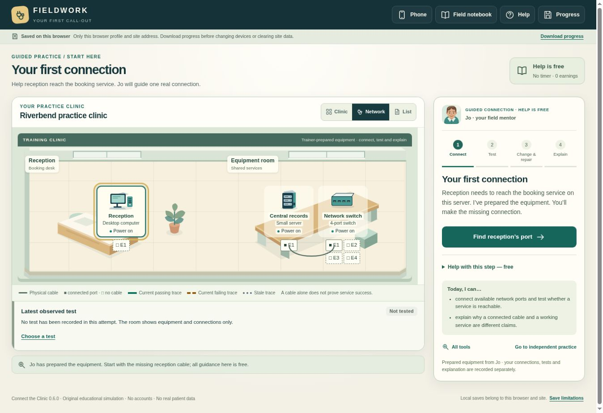

# GitHub Pages verification — Connect the Clinic 0.6.0

Verified 2026-11-16, completed by 11:15 UTC. This is a teacher review build, not a school-device certification.

- Runtime commit: `54778219b26ac56868027df49b1ce7f2aa468f1d`.
- Workflow: https://github.com/ctwadden/digital-society-sl/actions/runs/43855584127 — completed successfully.
- Observed final URL: https://ctwadden.github.io/digital-society-sl/connect-the-clinic/dist/
- Environment: managed Linux Chromium using the actual public HTTPS site, with no game account or sign-in.
- The copied project passed all 157 existing automated tests. All 13 deployed runtime files matched the original Git blob hashes. This migration changed no simulation or interface code.

## Observed on the published site

| Check | Observed result |
| --- | --- |
| Project entry and assets | Project root redirected to `dist/`; original art, ports, text, controls and version 0.6.0 rendered. |
| First connection | Reception Ethernet to switch port 2; fresh booking test reported `SERVICE_AVAILABLE` at technical revision 9. |
| Disconnect | Removing that cable marked the earlier pass stale; the fresh test reported `PORT_DISCONNECTED` at revision 10. |
| Repair | Reconnected through a different free switch port, port 3; fresh test reported `SERVICE_AVAILABLE` at revision 11. |
| Explanation and reload | Saved a clearly labelled developer deployment-check explanation. Reload retained the connection, current result and recorded-guided-observations stage. |
| Progress download | Downloaded 25,439-byte progress JSON; parsed successfully as the game's campaign schema. |
| Evidence download | Downloaded 6,512-byte readable evidence. It included the actual pass/fail/pass history, port 2 first connection, port 3 repair, unaltered explanation, trainer setup distinction and pending teacher review. |
| Damaged recovery | Pasted malformed JSON and confirmed import. The game rejected it and retained the completed guided attempt and current passing result. |
| Valid recovery | Pasted the previously downloaded complete progress JSON and confirmed import. The game restored the campaign and recalculated current readiness. |
| Multiple tabs | A second tab reported another tab had control; it opened read-only and disabled Start independent practice. The second tab was closed afterward. |
| Restart cancel | Cancel kept the recorded-guided-observations stage. |
| Restart confirm | Confirm reset the guided lesson to its prepared equipment, no reception cable and no recorded test. The review tab was left at the opening lesson. |

The console sample contained browser-extension metadata errors. It is not recorded as a clean application-console audit. The interactions and visible outputs above were observed directly.

## Still to check

- Actual school Windows/Edge/Chrome policies, filtering, keyboard/focus/zoom, storage retention, downloads, file-picker import and responsiveness.
- Transfer between actual home/school devices and browser profiles; private browsing and school profile cleanup behavior.
- Writer takeover and the complete independent/client mission on this GitHub origin. Prior development-browser checks are separate evidence.
- Teacher walkthrough and small student pilot, including how long a beginner takes to reach the first success.

Only synthetic developer explanations were used. Game income, speed, hint use and completion are not IB grades. The public code and screenshot contain no student or patient information.

